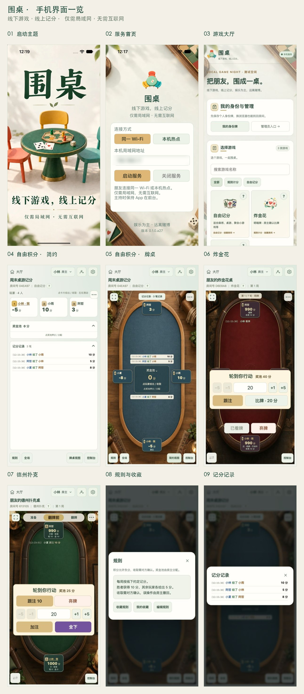
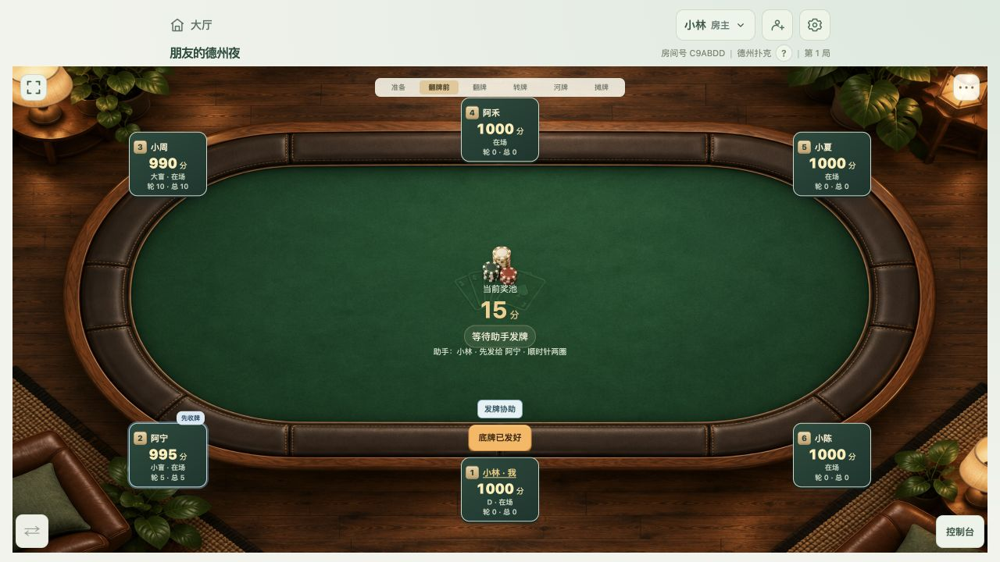
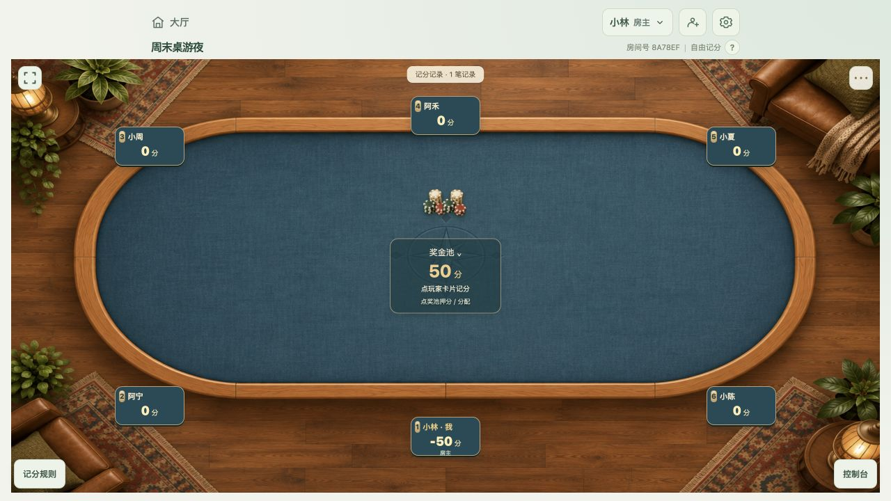
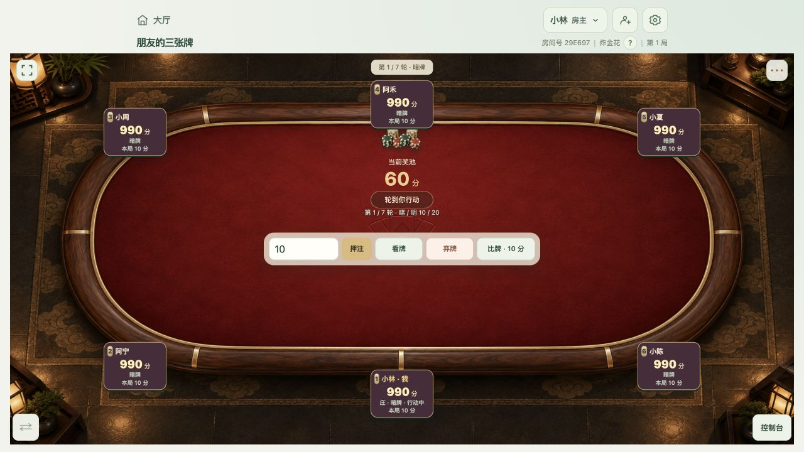
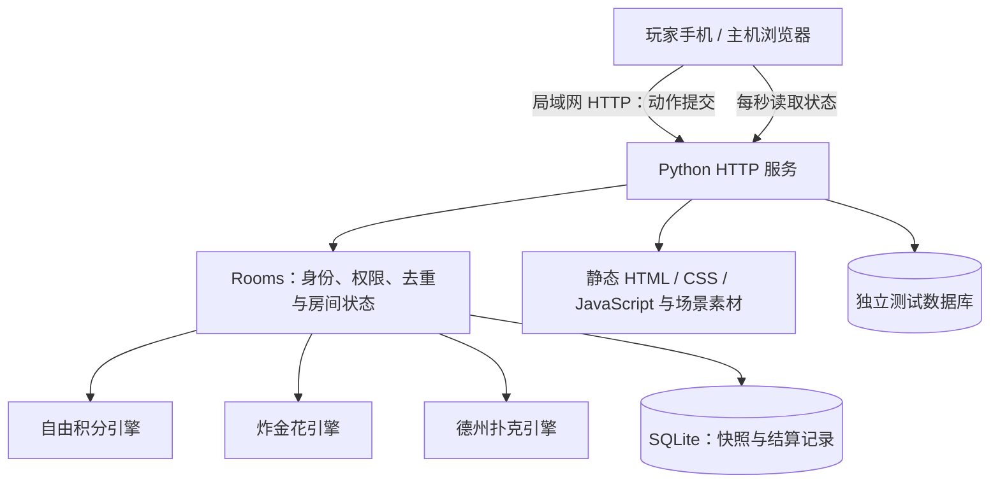

# 围桌（Weizhuo）

**线下游戏，线上记分，娱乐为主，远离赌博。**

- **公众号文章：[围桌项目介绍](https://mp.weixin.qq.com/s/uUYMiUiNHWGFk7n1Rvs5Dg)**

- 一台电脑或手机 App 启动服务，朋友连接同一局域网，用浏览器或微信扫码加入。
- **围桌只负责记分和现场流程提示**：实体牌和桌游在线下进行，由玩家发牌、判断牌型与胜负；应用不代玩、不生成手牌，也不自动判定赢家。

支持自由记分、炸金花和无限注德州扑克。当前是 **Python + SQLite + 原生 JavaScript 的局域网网页应用**，不提供现金、充值或提现功能。

- **围桌目前采用免云服务的局域网连接方式**：由现场一台设备运行服务，其他玩家连接同一 Wi-Fi，或连接服务设备开启的热点 Wi-Fi，通过浏览器加入。
- 运行无需云服务器、域名或公网 HTTPS，也无需互联网连接；房间与记分数据保存在服务设备上。
- 线下游戏通常是朋友在同一地点围桌而坐，家中或聚会场所往往已有可共同连接的 Wi-Fi，因此优先利用现场网络完成记分。
- 前提是玩家设备能与服务设备互通；访客网络或 AP 隔离可能阻止连接。
- **目前暂不考虑实现微信小程序、云开发等云服务方式，也不提供公网远程加入。**

## 安装与语音资源

- 安装包：[GitHub Releases](https://github.com/Snowdar/weizhuo/releases)，提供 macOS Apple Silicon ZIP 与 Android arm64 APK 测试版；iPhone 请按[构建指南](docs/BUILD_CLIENTS.md)自行签名，Windows 暂无预编译包。
- **完整正式音色资源已随仓库提供**：`resources/voice/` 包含 FP16 VITS 与已采纳 Serena 音频，共约 192 MiB；克隆后无需重新合成 Serena。运行资源准备命令后再构建，见[资源说明](resources/README.md)。
- VITS 权重的明确再分发许可尚未找到，按维护者决定随仓库提供；该资源不因此被标注为围桌自有许可或 Apache-2.0，见[核查记录](docs/VITS_LICENSE_REVIEW.md)。
- 当前纯 Python 启动入口尚未接入离线音色，电脑服务下另一设备扫码的房主也只能使用浏览器系统语音；桌面 App 的服务机本机房主可使用 VITS／Serena。资源齐全与这些功能限制分别说明。

## 已有功能

- **免云、离线局域网**：一台设备运行服务，其他玩家扫码用浏览器加入，无需安装 App。可连接同一 Wi-Fi，也可连接服务设备手动开启的热点 Wi-Fi；记分不依赖互联网。
- **房间与身份恢复**：房间和积分持久保存在服务设备的 SQLite 中；网页刷新、返回大厅后可重进原房间。个人身份恢复码用于找回身份及关联房间，支持默认昵称与个人规则收藏。
- **三种线下玩法**：自由记分支持给出、收取、全场多人交换、负分和可选奖金池；炸金花支持看牌、闷注／跟注、弃牌、比牌及赢家确认；德州支持盲注、前注、全下、主池与边池分配。
- **同步与核对**：房间状态、阶段与预选赢家实时同步；收取请求作为个人待办，可确认、拒绝或取消。成交记录、房间动态与本局下注历史方便核对，房主可撤回错误动作。
- **适合手机使用**：自由记分默认简约视图，可切换牌桌；牌桌支持沉浸与横屏，本人固定在底部，记录内部滚动，数字输入配有加减按钮，筹码投入与派奖提供动画反馈。
- **规则与现场管理**：房主设置玩法、调整座位、编辑全员可查看的规则；管理员入口仅向服务设备本机显示，支持改密与批量清理房间。
- **多 TTS 音色、房主设备播报**：默认仅房主设备播放提示音及中文播报，避免同桌多台设备重复发声；自由积分给出、收取请求发送与确认，扑克开局、发牌、行动及结算分别提示，连续事件逐条排队，不抢播。
- 桌面详情菜单可切换播报、仅提示音或关闭；首次进入、刷新、重复同步不重播旧记录。
- 配置完整声音资源后，iPhone、Android、Mac 与 Windows 均提供系统、离线男声、离线女声与 Serena 预制拼接播报（语速固定），全部本地生成或播放；声音默认仅由房主设备播报，按消息顺序播放。Android 与 iPhone 已实机试听，Windows 仍需目标系统验证。
- 未配置模型时使用系统离线语音，构建方式见 [离线播报](docs/OFFLINE_VOICE.md)，来源和授权边界见 [TTS 引用说明](THIRD_PARTY_NOTICES.md#tts-来源索引与复现环境)。
- 网页有本地中文音色时播报，否则只播放提示音。
- 需先点击界面以允许播放，主持设备保持前台。
- **VITS 端侧延迟**：iPhone 16 四线程预热测试，整句生成中位数约 479 ms，点击到软件首声中位数约 632 ms（P95 约 884 ms）；FP16 权重存储版本分别约 508 ms / 612 ms，未证明加速。两组均为独立测试，不含网页桥接、提示铃与排队等待，详见 [延迟数据与测量边界](docs/OFFLINE_VOICE.md#vits-端侧生成延迟与测量边界)。
- **本机启动器**：提供桌面与移动 App 工程，自动选择可用端口，启动后进入大厅，返回服务首页不停服。macOS arm64 已通过打包自检，iPhone 已做初步安装及同 Wi-Fi 接入验证；其他平台和热点互通的验证范围见对应文档。
- 系统热点须先手动开启，目前 App 不自动创建热点。
- iPhone 热点可用性受系统及蜂窝服务限制，不保证无信号时可开启；不接互联网的便携路由器可提供现场局域网。
- 移动主持须保持 App 在前台，不承诺锁屏或后台持续服务。
- 详见 [移动 App 说明](docs/MOBILE.md)。

## 为什么做这个项目

- 围桌主要用于验证 **Agent 参与软件开发的过程**，也用于锻炼人的产品判断、规则推演和逻辑思维，顺便让线下桌游记分更方便。
- 应用是验证这些思考的载体；从需求到实现、验证和纠错的过程，以及留下的设计约束，同样是项目的重要成果。
- 建议先读 **[从记分器到围桌：产品与 Agent 协作复盘](docs/PRODUCT_AGENT_RETROSPECTIVE.md)**。
- 这份文档记录重要迭代节点、人的判断贡献，以及 Agent 遇到什么问题、用什么证据定位、如何解决和验证：包括触摸滚动、iPhone 白屏与键盘、旧资源误打包、播报漏读与拼接接缝。
- 它是项目的重要成果，也是继续开发的经验入口。
- 后续开发的可执行约束沉淀在 [AGENTS.md](AGENTS.md)，复盘解释“为什么这样做”，开发约定负责“怎样继续做”。
- **本项目禁止商业使用，禁止作为赌博载体或将积分用于现实经济价值的输赢结算。**
- 允许非商业学习、研究、修改与免费分发，具体以 [许可证](LICENSE) 为准。
- 项目采用有用途限制的源码公开许可，不属于 OSI 定义的开源许可；本文所述公开源码不意味着允许商用。

## 双人德州操作演示

[观看或下载演示视频（MP4，含声音）](docs/media/holdem-two-player.mp4)

- 约 56 秒：介绍启动、服务、大厅与创建规则，随后演示双人德州开局、发底牌、All-in、弃牌及自动派奖，结尾邀请朋友体验。
- 对局采用两个同步竖屏画面：左侧为 1 号玩家小林的房主全屏视角，右侧为 2 号玩家小夏的普通视图；上方标注身份。
- 介绍使用 Qwen3-TTS Serena 配音，对局仅保留房主一路暖语播报。视频包含 8 条服务实际返回的游戏播报，按时序同步到录制画面；Serena 将全下读作 All-in，VITS 和系统声仍使用中文全下。
- 大厅和对局来自新版浏览器竖屏实际操作，使用独立测试数据；未变化的启动与服务页沿用模拟器录制片段。视频不代表手机真机验证。
- 围桌只负责流程提示与记分，线下实体牌由朋友自行发放和确认，不自动判断手牌。

## 实际游戏界面



- 九宫格展示启动主题、服务首页、大厅、自由积分简约／牌桌视图、炸金花、德州扑克、规则收藏与记分记录。
- 启动和服务首页截自 iPhone 16 模拟器，其余截自约 393×852 的手机浏览器视口；均为 build 27 实际运行界面，使用独立测试房间和虚构玩家，服务地址已模糊。
- 以下为当前版本浏览器实际运行截图，来自独立 `/test/` 测试空间，使用虚构玩家。
- 场景图片由 GPT Image 生成，昵称、分数、按钮、布局和游戏状态由应用实时渲染；这些截图不是 AI 生成的 UI 概念图。
- 截图用于展示界面，实际布局会随屏幕尺寸调整。

### 德州扑克：发牌协助与盲注



<details>

<summary>自由记分：奖金池、负分与规则入口</summary>



</details>

<details>

<summary>炸金花：看牌、押注与卡片比牌</summary>



</details>

截图说明与更新方法见 [截图记录](weizhuo/static/assets/screenshots/README.md)。

## 怎么玩

1. 服务设备连接现场 Wi-Fi，或先在系统设置开启热点 Wi-Fi，再启动服务；玩家连接同一 Wi-Fi 或该热点。
2. 房主在大厅选择游戏、设置规则并创建房间，分享房间邀请二维码。
3. 玩家扫码入座；实体发牌、判断牌型与胜负仍由人完成。
4. 在自己的卡片或桌面操作，房主 / 发牌协助者推进流程和确认结算。
5. 返回大厅保留座位；再次进入可继续原房间。真正退出使用“离开房间”。

| 游戏   | 记分方式                                                                                                                                                     | 房主 / 助手职责                                 |
| ---- | -------------------------------------------------------------------------------------------------------------------------------------------------------- | ----------------------------------------- |
| 自由记分 | 默认简约列表，可个人切换牌桌视图。点玩家给出或收取，默认 1 分；“全场”默认勾选所有其他玩家，可勾选部分人交换，每人金额分别计算，收取需逐人确认；允许负分。简约视图按时间显示记分记录，牌桌视图在奖池上下显示成交记录。奖金池默认关闭，房主可在创建或游戏设置中启用；启用后点奖金池押分，关闭前须分配完余额。 | 编辑全员可查看的记分规则；分配奖金池、录入全桌得失、撤回错误动作。         |
| 炸金花  | 明暗牌押注、看牌、弃牌与卡片比牌。默认第 1 轮可比牌，上限 7 轮，可设无限轮。默认允许负分，房主可在游戏设置中关闭；关闭后限制积分不足的投入。                                                                                | 默认准备，直接开始；比牌或达到轮次上限时点选合法赢家并确认。            |
| 德州扑克 | 小盲 / 大盲、前注、无限注、全下、退还未跟注投入、主池与边池。                                                                                                                         | 提醒先给谁发牌和烧牌步骤；逐池选择赢家，平牌分配，代记与撤回。协助者也可参与牌局。 |

- 自己的卡片固定在底部，玩家编号跟随身份。
- 支持沉浸模式和横屏，牌桌主页面不滚动；长记录在面板内查看。
- 结算选择同步给其他玩家，筹码投入和派奖有动画反馈。
- 非房主可自动准备，房主主动开始下一局。
- 详细玩法：[使用指南](docs/USAGE.md) · [规则参考](docs/RULES_REFERENCE.md) · [德州扑克流程](docs/HOLDEM.md) · [牌桌交互](docs/TABLETOP_UI.md)。

## 桌面启动器（测试版）

- 桌面应用名称为 **围桌**（macOS：`围桌.app`，Windows：`围桌.exe`），提供启动服务、打开大厅与停止服务界面。
- Mac 安装包仅提供 Apple Silicon（M 系列、arm64）版本，已通过打包自检；Windows 暂无预编译安装包，可在 Windows 电脑上使用 Agent 按构建教程自行构建，后续再考虑提供。
- 应用数据存于用户目录，升级不覆盖牌局。
- Mac arm64 与 Android arm64 测试安装包见 [Releases](https://github.com/Snowdar/weizhuo/releases)，构建和数据位置见 [桌面打包说明](docs/PACKAGING.md)。

## 客户端安装包与自行构建

- **安装来源提醒**：请优先安装自己从本项目源码构建的安装包，不要轻信其他来源的安装包，避免病毒或恶意程序风险。可以请 Agent 按仓库内的构建教程协助完成。
- **遇到安装问题**：直接截图，向任何你使用的 Agent 询问，并说明设备型号、系统版本和安装步骤；截图前遮蔽账号、身份二维码和其他敏感信息。
- 计划在 GitHub Release 提供 **Mac Apple Silicon ZIP 和 Android APK**；实际提供的文件以发布页为准。
- **Windows 暂无预编译安装包**：可在 Windows x86_64 电脑或 Windows 构建环境中，让 Agent 按 [客户端构建教程](docs/BUILD_CLIENTS.md) 自行构建；后续再考虑增加经过验证的 Windows 安装包。
- 当前预发布安装包见 [Releases](https://github.com/Snowdar/weizhuo/releases)；Mac 不提供 Intel 版本。
- 只有服务设备需要安装客户端，其他玩家扫码使用浏览器即可。
- **Release 不提供 iPhone 通用安装包。**
- iPhone App 需要 Apple 签名，请在自己的 Mac 上用自己的开发团队本地构建并安装；模拟器 App 和其他人的个人签名包不能直接当作通用 iPhone 安装包。
- 可以让 **Agent 帮你自行构建**。
- 将仓库交给 Agent，说明目标平台，让它先读 [客户端构建教程](docs/BUILD_CLIENTS.md)、[AGENTS.md](AGENTS.md) 和 [第三方资源说明](THIRD_PARTY_NOTICES.md)，检查设备与工具链，再按步骤构建、核对包内版本并验证启动。
- 账号登录、许可确认和签名配置由构建者完成；Agent 不替代这些条件。

| 目标        | 需要的构建设备和工具                                                                             | 构建入口与安装方式                                                                                         |
| --------- | -------------------------------------------------------------------------------------- | ------------------------------------------------------------------------------------------------- |
| Mac（M 系列） | Apple Silicon Mac、带 Tk 的 Python 3.11+、PyInstaller                                      | `python scripts/build-desktop.py --arch arm64`；解压 ZIP 后安装 `围桌.app`。                               |
| Windows   | Windows x86_64 电脑或 Windows 构建 runner、带 Tcl/Tk 的 Python 3.11+、PyInstaller               | `python scripts/build-desktop.py --arch x86_64`；完整解压 ZIP，运行 `围桌.exe`。不能在 Mac 上直接构建 Windows 包。     |
| Android   | Mac / Windows / Linux 构建机、Python（推荐 3.13）、Briefcase 管理的 JDK / Android SDK；测试另需安卓设备或模拟器 | `python scripts/build-mobile.py android --create --debug-apk`；首次须接受 SDK 许可，调试 APK 用于测试，公开版本需发布签名。 |
| iPhone    | Mac、完整 Xcode / iOS SDK、自己的 Apple 开发团队；真机安装需连接 iPhone 并开启开发者模式                          | `python scripts/build-mobile.py iOS --create`；在 Xcode 选择自己的 Team 与手机运行。只有 Command Line Tools 不够。  |

- 以上入口应使用已配置依赖的 Python 环境；首次环境安装、后续更新命令、产物位置与签名操作见 **[四个平台的逐步构建教程](docs/BUILD_CLIENTS.md)** 和 [iPhone 安装说明](docs/MOBILE.md#iphone-构建与安装)。
- 首次下载工具和依赖通常需要互联网，游戏运行只需局域网。
- 构建完成不等于真机验证通过：当前 Mac arm64 已完成打包自检和本机安装，iPhone 已完成个人签名实机安装，Android 已在 Mate 60 安装验证启动、Wi-Fi IPv4 检测及男女声／Serena 播报；Windows 尚未构建验证安装包，可使用 Agent 在目标系统自行构建，后续再考虑提供预编译包。

## 安装与源码启动

### 获取项目

安装 **Python 3.11 或以上**，将项目源码下载或克隆到本地并解压。

命令在仓库根目录执行（该目录包含本 README 和 `weizhuo/` 子目录）。将源码放在当前用户可写的目录，不要放进只读安装目录。

- 二维码运行依赖已随源码放在 `weizhuo/vendor/`，**运行不需要 pip 安装、Node.js、npm install 或前端 build**。
- Python 与源码齐备后可以离线运行。

### macOS / Linux

```sh
python3 --version
python3 scripts/bootstrap.py
python3 weizhuo/server.py
```

macOS 也可双击 `scripts/start-scoreboard.command`。如果下载的脚本没有执行权限，在仓库根运行：

```sh
chmod +x scripts/start-scoreboard.command
```

### Windows（PowerShell / 命令提示符）

```powershell
py -3 --version
py -3 scripts\bootstrap.py
py -3 weizhuo\server.py
```

- 也可双击 `scripts/start-scoreboard.cmd`。
- 未提供 `py` 的 Python 安装可将命令改成 `python`，并确认版本至少 3.11。
- Windows 启动脚本已提供，但尚未在实体 Windows 验证；Linux 也尚未做完整实机验证。

### 打开与停止

- 主机打开 <http://127.0.0.1:8765/>；其他设备打开 `http://主机局域网IPv4:8765/`，或扫描大厅二维码。
- 终端保持运行、电脑保持开机，按 `Ctrl+C` 停止；停止不删除房间和积分。
- 当前局域网 IP 自动识别主要面向 macOS。
- Windows 用 `ipconfig` 查看正在使用的网卡 IPv4；Linux 可查看网络设置。
- 二维码显示 `127.0.0.1` 时手动分享局域网链接，这个地址在朋友手机上指向手机自己。
- 系统防火墙提示时只按实际局域网使用需要配置，不必开放公网端口。
- 手机与服务设备需要网络互通：连接同一 Wi-Fi，或连接服务设备开启的热点 Wi-Fi。
- 玩家仅使用蜂窝网络无法直接访问局域网地址；访客 Wi-Fi / AP 隔离也可能阻止访问。

## Bootstrap、CLI 和桌面打包

| 入口                                | 当前状态                                                                        |
| --------------------------------- | --------------------------------------------------------------------------- |
| `scripts/bootstrap.py`            | 离线环境自检；不安装软件、不启动服务、不访问正式数据库。加 `--test` 运行完整检查。                              |
| `python3 weizhuo/server.py`       | 当前命令行启动入口；通过环境变量设置端口和管理员码。                                                  |
| macOS `.command` / Windows `.cmd` | 双击启动源码服务，仍需 Python。                                                         |
| 独立 `weizhuo` CLI                  | 尚未提供安装包、后台 start/stop/status 命令。                                            |
| macOS `.app` / Windows `.exe`     | 桌面启动器与构建脚本已提供；Mac 仅提供 Apple Silicon（arm64）包，已通过打包自检；Windows 暂无预编译安装包，可在 Windows 电脑上使用 Agent 按构建教程自行构建，后续再考虑提供。Mac arm64 与 Android arm64 测试安装包见 [Releases](https://github.com/Snowdar/weizhuo/releases)。 |

- 源码运行无需前端编译。
- 各平台逐步构建命令与统一移动构建脚本见 **[客户端构建教程](docs/BUILD_CLIENTS.md)**；支持范围和数据位置见 [桌面打包说明](docs/PACKAGING.md)。

## 配置与管理员

| 环境变量                    | 默认值    | 用途      |
| ----------------------- | ------ | ------- |
| `PORT`                  | `8765` | HTTP 端口 |
| `SCOREBOARD_ADMIN_CODE` | `1234` | 管理员授权码  |

macOS / Linux：

```sh
PORT=8765 SCOREBOARD_ADMIN_CODE='1234' python3 weizhuo/server.py
```

Windows PowerShell：

```powershell
$env:PORT = '8765'
$env:SCOREBOARD_ADMIN_CODE = '1234'
py -3 weizhuo\server.py
```

- 管理员初始密码为 `1234`；登录后可修改，密码以加盐摘要保存在当前数据目录，重启后仍有效，修改后旧管理员会话失效。
- 忘记密码时，在服务所在设备打开 `http://127.0.0.1:8765/admin/`，使用“本设备重置密码”；其他局域网设备不能重置。
- 若通过 `SCOREBOARD_ADMIN_CODE` 配置初始密码，重置恢复该配置值，页面提示也会相应调整。
- 正式和测试空间的密码互相独立。

大厅管理员入口仅在服务设备本机可见，其他玩家设备不显示；桌面启动器和手机 App 的本机大厅均可进入。

- 管理员入口 `/admin/` 支持单个或多选清理房间，勾选后一次确认即可，无需输入房间码。
- 清理前自动备份；若任一所选房间已变化，整批拒绝并要求刷新重新确认，批量清理在同一事务执行。
- 公开默认码仅用于可信局域网体验，共享部署时设置自己的授权码。
- `.env.example` 为配置示例，程序**不会自动加载 `.env`**。

服务默认监听所有网卡，当前 HTTP 和权限模型面向可信局域网，不应直接暴露公网。详见 [安全说明](SECURITY.md)。

## 服务电脑休眠与连接

屏幕熄灭本身不会停止 Python，但系统进入睡眠后局域网请求会暂停。请保持主机接通电源，并在系统设置中允许熄屏时继续运行；合盖行为还取决于系统设置和外接设备。

macOS 双击启动脚本在新启动服务时自动阻止系统空闲休眠（仍允许屏幕熄灭，关闭服务即解除；手动睡眠或合盖不保证保持服务）。已有服务不会被重启。源码启动也可以使用：

```sh
caffeinate -i python3 weizhuo/server.py
```

- 场景和图标使用 WebP 展示素材，合计约 1.8 MB；公开图片缓存 1 天，更新图片须更换文件版本名。
- 页面和脚本每次重验证，支持 gzip；房间状态、身份二维码与管理接口不缓存。
- 同一状态的并发刷新合并为一个请求，页面在后台时暂停定时同步，回到前台立即刷新；同步超过 2.5 秒显示慢连接提示。
- Windows 可在电源设置中将接通电源时的睡眠设置为“从不”。
- 浏览器提交时显示等待提示，8 秒未响应提示超时；连接中断自动重试，恢复可见页面立即同步。
- 积分操作不会自动重发，超时后先查看记录确认是否已执行，再继续。

## 身份与数据

- 自由记分的“规则”支持收藏；大厅个人身份牌中可打开“我的规则收藏”。
- 收藏绑定个人身份，保存规则文本快照，可复制规则；房主编辑时可从收藏填入，再保存到当前房间。
- 换设备扫描个人身份二维码可找回收藏。
- 保存个人身份二维码可恢复本人及参与房间，房间邀请二维码仅用于邀请别人。
- 个人身份二维码是凭证，请自己保管；相同浏览器重进可恢复房间，换浏览器、清除网站数据或改变访问地址后可重新扫码绑定。

房间动态与记分记录均按从早到新展示，最新消息在底部；进入时定位最新，上翻查看历史时保留阅读位置。

### 刷新、重进与持久保存

- **支持网页刷新与关闭后重进**：在同一浏览器、同一访问地址且身份存储未清除时，设备身份会恢复原玩家；回大厅可从“我参与的房间”继续进入。刷新或返回大厅不等于离开房间。
- **身份独立于昵称**：昵称不是识别本人的凭证。个人身份二维码用于换浏览器或换设备恢复原身份；房间邀请二维码只邀请入房，不能恢复原玩家。请在清除浏览器数据前保存个人身份牌。
- **房间持久存在**：房间、积分和已保存牌局写入 SQLite，服务正常重启后仍可继续；房间不会因所有人关网页而自动销毁，主动销毁或管理员清理属于明确删除操作。真正退出座位请点“离开房间”。
- **数据在服务设备**：数据库保存在启动服务的电脑或主持手机 App 的私有数据目录；玩家浏览器保存身份与个人界面偏好，不保存权威全桌数据库，也没有云端备份。换主机需迁移数据库，删除数据目录或卸载手机 App 可能丢失房间，升级前请备份。
- **保存不等于永远在线**：主机停服、休眠或手机主持离开前台时，其他玩家可能暂时无法接入；恢复服务后再同步。提交超时不要反复点同一动作，先核对记录；尚未提交的输入不等于已保存动作。

| 路径                                     | 内容                |
| -------------------------------------- | ----------------- |
| `weizhuo/data/scoreboard.sqlite3`      | 正式房间、身份凭证、积分和对局记录 |
| `weizhuo/data/test_scoreboard.sqlite3` | `/test/` 独立测试空间   |
| `weizhuo/data/backups/`                | 管理员清理前的备份         |


- 运行数据均排除在 Git 外。
- 升级先备份，保留 `data/`；不要删除数据库完成迁移，不启动多个服务共写数据库。
- 重启前核对所有正式房间，不只看默认房间。
- 备份与恢复见 [操作说明](docs/BACKUP.md)。

## 技术架构



服务端决定权限、积分和合法动作；浏览器负责布局、输入及反馈。当前用轮询同步，没有 WebSocket；单主机、单进程部署，不依赖云服务。

```text
weizhuo/
  server.py            HTTP、静态文件、二维码、管理员接口
  scoring/             房间权限、游戏引擎、SQLite 仓储
  static/              大厅、牌桌、管理页面、GPT Image 素材和截图
  vendor/              带许可证的纯 Python 二维码依赖
  test_*.py / *.cjs    规则、身份、权限及界面回归检查
scripts/               自检、启动与完整检查
docs/                  使用、设计、架构、备份与发布说明
```

详见 [架构说明](docs/ARCHITECTURE.md)。

## 开发与验证

- 先阅读 [AGENTS.md](AGENTS.md) 中的人本设计约定，再阅读 [贡献指南](CONTRIBUTING.md)。
- 开发用 `/test/`，不同 `device` 参数可模拟不同浏览器身份；不要操作正式牌局做测试。

完整检查另需 Node.js（CI 使用 22）：

```sh
python3 scripts/bootstrap.py --test
# 或
python3 scripts/check.py
```

- 测试使用独立或临时数据库，不启动正式服务。
- 规则和权限修改需要有意义的回归测试，UI 还需实际检查手机竖屏、短屏、横屏、十人桌及键盘展开。
- 静态修改刷新生效，后端修改需备份后重启。

## 素材、作者与许可

- **标志、游戏图标、牌桌一体场景和筹码贴图均由 GPT Image（gpt-image）通过图像生成工具生成。**
- 页面布局、文字和可操作 UI 由代码实现；截图来自应用运行。
- 素材清单、来源和提示词说明见 [ASSETS.md](weizhuo/static/assets/ASSETS.md) 和 [牌桌素材记录](docs/TABLETOP_UI.md)。

- 作者：**Snowdar** · 联系邮箱：`snowdar@qq.com`。
- 本项目由 Snowdar 使用 Agent 协作设计与开发：Snowdar 主要贡献于产品功能、业务逻辑、规则、UI 美观和交互体验，也负责部分算法方向与实现策略的引导；Agent 主要负责技术架构、代码实现与验证。

- 原创代码、文档及作者有权许可的随附素材采用 [围桌非商业与非赌博用途许可证 v1.0](LICENSE)。
- **仅供非商业学习交流，禁止商用及赌博用途，保留相应权利人的版权与许可声明。**
- 第三方代码、运行时、模型、音色及生成资源分别遵循其上游条款，本项目许可证不能替代第三方许可。
- TTS 使用 Apple 系统语音、sherpa-onnx / ONNX Runtime 与可选 VITS zh-ll 音色，以及开发时由 Qwen3-TTS Serena 生成的预制 WAV。
- Qwen 大模型不装入手机，暖语使用整句模板与上下文片段拼接。
- VITS 的音色及训练数据授权尚待确认，不作为已获公共分发许可的资产。
- 完整来源、版本、许可及使用方式见 [第三方说明](THIRD_PARTY_NOTICES.md#tts-来源索引与复现环境)。
- 四端统一提供系统、VITS 男声、VITS 女声和 Serena 预制拼接播报；离线三音色复用同一模型与素材，系统音色由各平台提供。iPhone 与 Android 已实机试听，Mac 和 Windows 使用服务设备本地合成，Windows 尚待目标系统验证。完整四音色构建须预先配置语音资源。

提交问题请用测试房间复现，不上传真实数据库、个人身份二维码、授权码或含凭证的日志。问题模板、贡献指南和安全报告入口均已提供。

## 安卓与 iPhone App（暂未计划上架应用商城，可自行构建测试版）

- 移动 App 用于让房主在手机上运行服务，其他玩家连接同一 Wi-Fi 或服务设备热点 Wi-Fi，扫码用浏览器加入。
- 暂时未计划上架应用商城，可以按 [客户端构建教程](docs/BUILD_CLIENTS.md) 自行构建测试版；Android 可安装自行构建的 APK，iPhone 需通过 Xcode 使用自己的开发团队签名安装。
- 支持无需互联网的同 Wi-Fi 运行；新增本机热点地址识别入口，系统热点互通仍待真机验证，尚不自动创建热点，也不支持后台常驻主持。
- 无信号场景可使用不联网的便携路由器；安卓本地热点自动创建待实现，iPhone 个人热点受系统与蜂窝服务限制。
- App 首页采用围桌主题背景和与大厅一致的控件风格，明确提示“仅需局域网，无需互联网”；提供启动与关闭服务，启动后直接进入大厅；大厅悬浮入口可返回服务首页，返回不会停服。
- 切换 Wi-Fi 或热点后，首页自动检测本机 IP；地址变化时提示重启服务，由房主确认后重新分享二维码，房间与积分保留。
- 个人 Xcode 测试安装需要开发者模式，免费个人签名通常七天有效；TestFlight 分发需要开发者计划会员。
- 构建方法与使用限制见 [移动 App 说明](docs/MOBILE.md)。


### 局域网连接检查

- 服务设备进入大厅，在“扫码加入大厅”区域点“检查局域网连接”；该入口仅服务机可见。
- 首先检查本机服务和邀请 IP。自测成功只能证明服务机访问自己正常，不能证明其他设备能连上，也不能据此排除 Wi-Fi 隔离。
- 用另一台设备连接同一 Wi-Fi 或服务机热点，扫描诊断二维码；服务机会显示是否收到对方访问，二维码 3 分钟内有效。扫码检查不创建房间、不修改积分。
- 另一台设备打不开时，核对当前地址和网络，排查访客 Wi-Fi、AP／客户端隔离、防火墙、VPN 与局域网权限。可以换服务设备热点再试；无法仅凭超时确定是哪项原因。
- 换网络后先在服务机重启服务，再分享新的房间二维码让玩家重新扫码。诊断是四端共用网页功能，需要使用包含新版源码的客户端；旧安装包不会自动更新。
